# Antigravity Video Studio (`v2` $\rightarrow$ `v3`) & `bleequp-ranger-sync` — Phase 1 Architectural Audit

- **Audit Date:** November 11, 2026
- **Audit Mode:** Phase 1 Read-Only Inspection (Zero production files modified)
- **Repositories Audited:**
  - `antigravity-video-studio`: `.` (`24` Python scripts across root, `.agents/skills/*/scripts/`, and legacy catalog; `9` skill definitions)
  - `bleequp-ranger-sync`: `~/src/bleequp-ranger-sync` (`7` package modules under `src/ranger_sync/` + `tests/test_ranger_sync.py`, installed editable as `/opt/homebrew/bin/ranger-sync`)
- **Golden Production Reference Projects:**
  - `04_Project_Catalog/2026/2026-11-05_Femenia_Climbing` (Cycling ride + 1Hz GPX HUD + longitudinal Strava overlay + bilingual speech cards + AI creative flashbacks)
  - `04_Project_Catalog/2026/2026-11-10_Another_Day_In_Paradise` (Narrative coastal/social story + global `hud_mode: "off"` with per-cut `hud: true` override + BleeqUP RTC brownout & `91ms` batch-remux recovery + `calibration_clock_only` exclusion)

---

## 1. Current System Inventory & Dataflow Map

### 1.1 End-to-End Production Execution Flow

```mermaid
flowchart TD
    subgraph Tier2["Tier 2: Hot Media (~/Movies/YEAR/<project>/)"]
        RAW["Raw Camera + Telemetry Drop\n• BleeqUP: VIDEO_<13d>.MP4, IMG_<13d>.JPG\n• iPhone: IMG_*.MOV, IMG_*.HEIC\n• Garmin Edge 1040: *.gpx\n• Archival Symlinks: ../../Archival_Pulls/LR_Published_4K/*"]
    end

    subgraph Stage0["Stage 0: Ingest, Sync & Collaborative Storyboard (/storyboard)"]
        RS["ranger-sync apply\n(bleequp-ranger-sync CLI)\n• Clock-skew solver & physical overlap gate\n• ExifTool QuickTime/EXIF/GPS + btime/mtime\n• Filename 13-digit epoch rename"]
        ING["ingest_and_sync_media.py\n• .HEIC -> 4K .jpg (sips)\n• .proxies/*_thumb.jpg & 3x2 *_strip.jpg (ffmpeg)\n• 40m-lookback GPX parser + editorial scoring\n• CreatorMix non-reuse music recommender"]
        FB["find_gpx_flashbacks.py\n• Read-only SQLite scan of Lightroom .lrcat (<100m)\n• Stages Previews.lrdata JPEGs in .flashback_candidates/"]
        SB["Storyboard.md + my_digital_brain.md\n• Controlling idea, scene breakdown, EN/UA/RU scripts\n• Section 5 YAML tuning knobs"]
    end

    subgraph Stage1["Stage 1: Declarative Timeline Build & Render (/build-timeline)"]
        SPEC["timeline_spec.json\n• Declarative cuts, vo_cues, overlays,\n  boosted_dialogs, sfx_cues, bookends, hud_mode"]
        VO["generate_voiceover.py\n• Gemini 3.8 Flash TTS ($GEMINI_VOICE_ID)\n• Studio-Dry dereverb chain -> voiceover_{lang}_{cue}.wav"]
        OVL["gpx_widgets.py + agvs_bookends.py\n• Warm Vintage (#F4EFE6 / #231F1D / #B83A2A) PNG cards\n• 1Hz live_hud/ & live_hud_ru/ overlays\n• 4K Intro Postcard & Outro Bar Tab MP4s (EN + RU)"]
        BLD["build_timeline.py + assemble_engine.py\n• Pre-flight: zero-script, monotonic GPX, calibration guard\n• FFmpeg EBU R128 stems: full_audio_{en,ua,ru}.{wav,m4a}\n• FilmCraft schema v17 .fcproj + V1 zero-gap verifier"]
        RND["FilmCraft Export & Edition Muxing\n• filmcraft-cli export -> <project>.mp4 (4K)\n• captions.{en,ua,ru}.srt\n• Localized _RU.mp4 (+ _UA.mp4 target)"]
    end

    subgraph Stage2["Stage 2: Headless Release (/publish-youtube & /publish-flickr)"]
        META["generate_youtube_metadata.py + generate_facebook_promo.py\n• Imperial-first EN + Metric UA/RU metadata\n• 16:9 localized composite thumbnails\n• facebook_promo.md"]
        YT["upload_youtube_api.py (Human Gate Required)\n• Resumable upload (unlisted default)\n• ua -> uk API boundary mapping\n• SHA-256 .srt hash cache + pinned switcher comment"]
        FL["upload_flickr_api.py\n• OAuth 1.0a _RU.mp4 upload (<980MB guard)\n• GPX geotag + Album + WhatsApp snippet"]
    end

    RAW --> RS --> ING
    ING -->|"project_manifest.json"| SB
    FB --> SB
    SB --> SPEC
    SPEC --> VO & OVL --> BLD --> RND
    RND --> META --> YT & FL
```



### 1.2 Python Script & Module Inventory

#### A. `antigravity-video-studio` (`24` Python files)

| File Path (Relative to `STUDIO_ROOT`) | Lines | Skill / Layer | Role & Primary Consumers |
| :--- | ---: | :--- | :--- |
| `studio_config.py` | 293 | Root Config | Parses `studio.conf`, resolves Tier 1/2/3 storage paths, locates active `.lrcat`, fetches `$GEMINI_VOICE_ID` (env $\rightarrow$ 1Password `op` CLI). |
| `.agents/skills/ingest-media/scripts/ingest_and_sync_media.py` | 974 | `/ingest-media`, `/storyboard` | Converts `.HEIC` $\rightarrow$ `.jpg`, invokes `ranger-sync`, extracts `.proxies/`, parses GPX (`40m` lookback), optionally refines cafe-stop sync via Gemini Vision, writes `project_manifest.json`. |
| `.agents/skills/ingest-media/scripts/extract_video_subclips.py` | 238 | `/ingest-media` | Uses `ffmpeg` `scdet` + `volumedetect` to segment long clips ($\ge 12\text{s}$) into subclips inside `project_manifest.json`. |
| `.agents/skills/ingest-media/scripts/fetch_yt_broll_clip.py` | 55 | `/ingest-media`, `/build-timeline` | Downloads frame-accurate YouTube flashback slices via `yt-dlp --download-sections` into `~/Movies/Archival_Pulls/`. |
| `.agents/skills/ingest-media/scripts/index_lightroom_catalog.py` | 89 | Archive Setup | One-off SQLite dumper indexing Lightroom `.lrcat` assets into `00_Archive_Indexes/`. |
| `.agents/skills/storyboard/scripts/find_gpx_flashbacks.py` | 516 | `/storyboard` | Scans active `.lrcat` within `100m` of GPX trackpoints; clusters rated/published 4K photos & unrated gems; stages `Previews.lrdata` JPEGs. |
| `.agents/skills/storyboard/scripts/generate_ai_creative_assets.py` | 458 | `/storyboard` | Synthesizes 16:9 `paint_morph`, `fpv_drone`, and `living_memory` MP4s via `google-genai` image + video models. |
| `.agents/skills/build-timeline/scripts/build_timeline.py` | 1,411 | `/build-timeline` | Declarative orchestrator reading `timeline_spec.json`: runs pre-flight gates, paces VO, mixes `full_audio_{en,ua,ru}.m4a`, builds `.fcproj`, runs `filmcraft-cli` export, writes `.srt`. |
| `.agents/skills/build-timeline/scripts/assemble_engine.py` | 705 | `/build-timeline` | Shared timeline math: V1 zero-gap continuity verifier/repair, 4:3/9:16 blurred backdrop builder, BGM RMS gain calculator, A2 outro fade helper, `.srt` writer. |
| `.agents/skills/build-timeline/scripts/gpx_widgets.py` | 1,374 | `/build-timeline` | Renders Warm Vintage callout badges (`character_badge`, `flashback_badge`, `strava_comparison`), paginated bilingual `translation_subtitle` cards, GPX corner maps, and 1Hz `live_hud` PNGs. |
| `.agents/skills/build-timeline/scripts/agvs_bookends.py` | 1,349 | `/build-timeline` | Renders 4K30 `bookend_intro_4K[_RU].mp4` (route map + wax seal + live motion stamp) and `bookend_outro_4K[_RU].mp4` (post-ride bar tab + credits). |
| `.agents/skills/build-timeline/scripts/generate_voiceover.py` | 259 | `/build-timeline` | Synthesizes EN/UA/RU narration via `gemini-3.8-flash-tts` (`replicated_voice_config`) and applies Studio-Dry dereverb chain. |
| `.agents/skills/build-timeline/scripts/register_replicated_voice.py` | 219 | Voice Setup | Registers speaker sample + verbal consent clip via `client.voices.create` (`v1beta`). |
| `.agents/skills/build-timeline/scripts/check_filmcraft_env.py` | 272 | `/build-timeline` | Pre-flight check for `FilmCraft.app`, `filmcraft-cli >= 0.17.0`, cache dir, and live TCP `:9876` command capability diff against `filmcraft_capabilities.json`. |
| `.agents/skills/publish-youtube/scripts/generate_youtube_metadata.py` | 544 | `/publish-youtube`, `/build-timeline` | Builds `youtube_metadata.json` (EN Imperial + UA/RU Metric titles, descriptions, `00:00` chapters) and localized 16:9 Pillow composite thumbnails (`rembg` cutout + sticker outline). |
| `.agents/skills/publish-youtube/scripts/upload_youtube_api.py` | 748 | `/publish-youtube` | Headless YouTube Data API v3 uploader (`en_only`, `option_a`, `option_b`), `ua -> uk` mapper, SHA-256 `.srt` hash cacher, thumbnail uploader, playlist inserter, and switcher commenter. |
| `.agents/skills/publish-youtube/scripts/generate_facebook_promo.py` | 382 | `/publish-youtube` | Generates `facebook_promo.md` + extracts clean still frames from exported MP4. |
| `.agents/skills/publish-youtube/scripts/upload_youtube_studio_chrome.py` | 208 | Legacy v1 | Deprecated AppleScript + Chrome UI uploader (superseded by `upload_youtube_api.py`). |
| `.agents/skills/publish-youtube/scripts/extract_facebook_stills.py` | 56 | Legacy v1 | Hardcoded one-off frame extractor for `2026-10-27_Buger_coffee`. |
| `.agents/skills/publish-flickr/scripts/upload_flickr_api.py` | 614 | `/publish-flickr` | OAuth 1.0a Flickr uploader (`_RU.mp4` default, `<980 MB` 1080p auto-transcode guard), GPX geotagger, album manager, and YouTube cross-commenter. |
| `.agents/skills/find-music/scripts/fetch_creatormix_catalog.py` | 293 | `/find-music`, `/ingest-media` | Scrapes/caches `creatormix.com` catalog (`134` tracks), filters out tracks used in past `Storyboard.md`/`.fcproj` files, downloads & indexes MP3s. |
| `.agents/skills/find-music/scripts/save_music_track.py` | 111 | `/find-music` | Moves newest audio file from `~/Downloads` into `03_Audio_Library/01_Curated_BGM/<category>/` with `[BPM]_[Mood]_[Title]_[Artist].mp3` naming. |
| `.agents/skills/relink-archive/scripts/relink_project_media.py` | 98 | `/relink-archive` | String-replaces `~/Movies` $\leftrightarrow$ `/Volumes/Crucial-4T/Movies` in `.fcproj` and `project_manifest.json` (+ optional DaVinci Resolve `RelinkClips`). |
| `04_Project_Catalog/2026/2026-10-27_Buger_coffee/build_buger_coffee.py` | 851 | Legacy v1 | Hardcoded per-project timeline builder (predates Zero-Script Law). |

#### B. Companion `bleequp-ranger-sync` (`~/src/bleequp-ranger-sync/src/ranger_sync/`)

| Module | Lines | Responsibility |
| :--- | ---: | :--- |
| `models.py` | 95 | Dataclasses `MediaKind`, `TrackPoint`, `GpxFix`, `MediaItem` (`corrected_epoch_ms`, `new_filename_for_shift()`). |
| `parser.py` | 185 | Classifies 5 BleeqUP filename regexes + iPhone `IMG_\d{4,5}`; batch-reads metadata via `exiftool -json -n`. |
| `anomaly.py` | 346 | Enforces `check_physical_overlaps` / `assert_physical_continuity` (`PhysicalOverlapError`), solves whole-ride & mid-ride sleep-oscillator skew (`auto_detect_clock_skew`), pairs dual-camera shots. |
| `gpx.py` | 211 | `GpxIndex`: multi-GPX parser, stationary cafe-pause detector (`dist <= 150m`, `span <= 7200s`), linear WGS84 + elevation interpolator. |
| `vision_match.py` | 118 | Runs inline Swift `VNGenerateImageFeaturePrintRequest` subprocess to pair `BleeqUp_Motion_*` stylized images to source `IMG_*` captures. |
| `injector.py` | 258 | Single-process `exiftool -@ -` batch writer for EXIF/QuickTime/Keys/ISO6709 GPS + macOS `btime`/`mtime`, JPEG-in-PNG swap handler, and shifted-epoch file renamer. |
| `cli.py` | 367 | `ranger-sync inspect` & `ranger-sync apply` CLI (`exit 2` on `PhysicalOverlapError`). |

### 1.3 External Binary & Runtime Dependency Matrix

| Binary / Service | Resolved Path on Host | Invoking Scripts | Hardcoded vs `PATH` Lookup |
| :--- | :--- | :--- | :--- |
| `filmcraft-cli` | `/Users/akomlik/.local/bin/filmcraft-cli` | `build_timeline.py:1185`, `check_filmcraft_env.py:85` | `shutil.which` + fallback `~/.local/bin/filmcraft-cli` |
| `FilmCraft.app` (`:9876`) | `/Applications/FilmCraft.app` | `check_filmcraft_env.py:67,139`, `filmcraft` MCP | Hardcoded `/Applications/FilmCraft.app` + `~/.filmcraft/mcp-token` |
| `ffmpeg` | `/opt/homebrew/bin/ffmpeg` | `ingest_and_sync_media.py`, `extract_video_subclips.py`, `generate_voiceover.py`, `agvs_bookends.py`, `build_timeline.py`, `upload_flickr_api.py`, `generate_facebook_promo.py` | Mixed! `build_timeline.py:338,410,564,1246` & `build_buger_coffee.py:767` hardcode `"/opt/homebrew/bin/ffmpeg"`; others use `"ffmpeg"`. |
| `ffprobe` | `/opt/homebrew/bin/ffprobe` | `ingest_and_sync_media.py`, `extract_video_subclips.py`, `agvs_bookends.py`, `build_timeline.py`, `assemble_engine.py`, `generate_voiceover.py` | Mixed! `build_timeline.py:296,683` & `assemble_engine.py:249` hardcode `"/opt/homebrew/bin/ffprobe"`; others use `shutil.which`. |
| `exiftool` | `/opt/homebrew/bin/exiftool` | `ranger_sync/parser.py:27`, `ranger_sync/injector.py:184` | `shutil.which` + `/opt/homebrew/bin/exiftool` fallback. *(Never used directly by `ingest_and_sync_media.py`!)* |
| `ranger-sync` | `/opt/homebrew/bin/ranger-sync` | `ingest_and_sync_media.py:135` | Subprocess CLI call (`shutil.which("ranger-sync")`); no Python API import. |
| `sips` | `/usr/bin/sips` | `ingest_and_sync_media.py:98,190,384` | `"sips"` via `PATH` (macOS built-in). |
| `qlmanage` / `mdls` | `/usr/bin/{qlmanage,mdls}` | `ingest_and_sync_media.py:184,360` | Fallback when `ffmpeg`/`ffprobe` unavailable. |
| `swift` | `/usr/bin/swift` | `ranger_sync/vision_match.py:80` | `shutil.which("swift")` (`swift -e` inline Vision framework script). |
| `yt-dlp` | `/opt/homebrew/bin/yt-dlp` | `fetch_yt_broll_clip.py:34` | `shutil.which("yt-dlp")` |
| `op` (1Password CLI) | `/opt/homebrew/bin/op` | `studio_config.py:270` | `op item get envvar:GEMINI_VOICE_ID --vault Private` |

> **Packaging Gap (`requirements.txt` vs Actual Imports):**
> [`requirements.txt`](./requirements.txt) lists only 4 packages (`google-api-python-client`, `google-auth-oauthlib`, `google-auth-httplib2`, `Pillow`), omitting `google-genai` (used by `generate_voiceover.py`, `register_replicated_voice.py`, `ingest_and_sync_media.py`, `generate_ai_creative_assets.py`), `requests` + `requests-oauthlib` + `oauthlib` (`upload_flickr_api.py`), `rembg` + `numpy` (`generate_youtube_metadata.py`), `pyyaml` / `pydantic` (needed for spec validation), and `pytest` (missing from `.venv/bin/`).

---

## 2. Dead Code, Duplication & Spec Drift

### 2.1 Orphaned Scripts, Dead Functions & Hardcoded Ride Artifacts

1. **Legacy Per-Project Script Bypassing Pre-Flight Guard:**
   - `04_Project_Catalog/2026/2026-10-27_Buger_coffee/build_buger_coffee.py` (`851` lines) is a hardcoded v1 assembly script with frozen `/Users/akomlik/...` paths (`:23-26`).
   - `check_zero_project_scripts_preflight()` in `build_timeline.py:169` only globs `assemble_*.py` and `build_*_overlays.py`, so `build_<project>.py` escapes detection.
2. **Deprecated v1 Scripts in `.agents/skills/publish-youtube/scripts/`:**
   - `upload_youtube_studio_chrome.py` (`1–208`): Fragile AppleScript + Chrome UI clicker superseded by `upload_youtube_api.py`; defaults to `--visibility private` (`:177`).
   - `extract_facebook_stills.py` (`1–56`): Hardcodes `2026-10-27_Buger_coffee` clips (`IMG_8476.MOV`, `VIDEO_1793094211149.MP4` at `:21-29`); superseded by `extract_key_frames()` inside `generate_facebook_promo.py:123-163`.
3. **Stray Tracked System Skill Copy:**
   - `skills/system/run-workflow/SKILL.md` (`1–192`) sits in `./skills/` outside `.agents/skills/` (subsequently added to `.gitignore:7` as `/skills/`, check `git ls-files skills/`).
4. **Dead / Unwired Shared Engine Helpers:**
   - `assemble_engine.py:353-369` (`filter_vo_cues_for_same_language_dialog`): Written to enforce the Non-Negotiable Audio Invariant that narration on `A4` never overlaps same-language live speech on `A1`, **but is never imported or called anywhere in the codebase**. Worse, its signature expects 3-tuples `(cue_key, st, ed)` instead of `timeline_spec.json` dicts `{"id": ..., "start_s": ..., "max_dur_s": ...}`.
5. **Project-Specific Hardcoding Leaking into Shared Engine Scripts:**
   - `ingest_and_sync_media.py:415`: Hardcodes `if filepath.name in ("IMG_1794306860718.JPG",)` from the Nov 10 ride to set `calibration_clock_only = True`.
   - `agvs_bookends.py:1251, 1273`: Fallback defaults in `render_project_bookends()` hardcode `Femenia_Climbing` clips (`"VIDEO_1793866633305.MP4"` and `"IMG_8801_rotated.MOV"`) and route text (`"BONAIRE  ➔  COLL DE FEMENIA & MORTITX"` at `:1262-1263`).
   - `generate_youtube_metadata.py:229, 471-473`: CLI `--thumb-text` defaults to `"SAVED AT THE GATE"` (from Nov 2 `Nina_Pollenca_Loop`). Because `args.thumb_text` is non-empty by default, line `471` (`t_en = args.thumb_text or sb_thumb_cfg.get("headline_text") or "THE 140 BPM RULE"`) **always overrides `Storyboard.md`'s `headline_text`** unless `--thumb-text` is explicitly passed on the CLI!
   - `generate_facebook_promo.py:57-114, 189-220`: Contains hardcoded `if "SaPobla_Market_Trip" in proj_name:` / `elif "Nina_Pollenca_Loop" in proj_name:` / `elif "Buger_coffee" in proj_name:` narrative branches instead of reading `Storyboard.md` / `youtube_metadata.json`.
   - `register_replicated_voice.py:129`: Hardcodes `--rebuild-project` default to `04_Project_Catalog/2026/2026-11-07_PCH_Saturday_partial`.

### 2.2 Cross-Skill Code Duplication Matrix

| Duplicated Capability | Copies Found Across Codebase | Drift / Inconsistency Between Copies |
| :--- | :--- | :--- |
| **GPX Parsing & Haversine Math** | **6 implementations:** `ingest_and_sync_media.py:216`, `gpx_widgets.py:39`, `agvs_bookends.py:196`, `find_gpx_flashbacks.py:54`, `upload_flickr_api.py:232`, `ranger_sync/gpx.py:49` | `ingest_and_sync_media.py:275` uses the constitutional `>= 40 m` grade window; `gpx_widgets.py:78-81` uses a `5-point` (`> 5 m`) window; `agvs_bookends.py` & `upload_flickr_api.py` ignore Garmin `TrackPointExtension` (`hr`, `cad`, `power`). |
| **macOS `.ttc` Font & Cyrillic Loader** | **3 implementations:** `gpx_widgets.py:100-149`, `agvs_bookends.py:104-174`, `generate_youtube_metadata.py:249-278` | `gpx_widgets.py` & `agvs_bookends.py` enforce Cyrillic stroke-weight parity (`HelveticaNeue.ttc` index `1` Bold); `generate_youtube_metadata.py:255` loads `Impact.ttf` / `Arial Bold.ttf` without `.ttc` index handling or Cyrillic glyph checks. |
| **SRT Timestamp Formatter & Writer** | **3 implementations:** `assemble_engine.py:673`, `generate_youtube_metadata.py:148`, `build_buger_coffee.py:109` | `assemble_engine.py` formats from `(start_s, end_s, text)` tuples; `generate_youtube_metadata.py` parses FilmCraft tick captions (`ticks / 254016000000`). |
| **`STUDIO_ROOT` & `sys.path` Bootstrap** | **14 scripts** repeat `Path(__file__).resolve().parents[4]` + `sys.path.insert(0, ...)` | Some scripts honor `ANTIGRAVITY_STUDIO_ROOT` env var; others (`find_gpx_flashbacks.py:26`, `generate_ai_creative_assets.py`) do not; several bypass `studio_config.py` and hardcode `Path("~/Movies/Exports").expanduser()` (`build_timeline.py:1304`, `upload_flickr_api.py:172`). |
| **`music_catalog.json` Updater** | **2 implementations:** `fetch_creatormix_catalog.py:229-255`, `save_music_track.py:81-106` | Slightly different JSON fields (`album`, `duration_s` present in `fetch_creatormix_catalog.py`, missing in `save_music_track.py`; `saved_at` present in `save_music_track.py`, missing in `fetch_creatormix_catalog.py`). |
| **Subclip Manifest Key** | `extract_video_subclips.py:149` vs `ingest_and_sync_media.py:923` | `extract_video_subclips.py` writes `item["sub_clips"]` (with underscore), while `ingest_and_sync_media.py:923` preserves `"subclips"` (no underscore), silently dropping extracted subclips on re-ingest! |

### 2.3 Specification Drift (`editing_constitution.md` / `SKILL.md` vs Python Code)

1. **0.2s Lossless Multi-Language Remux vs. 1080p Dual-Encode & Missing `_UA.mp4`:**
   - **Documented Invariant** (`GEMINI.md`, `editing_constitution.md:223`, `README.md:44,82,94`, `publish-flickr/SKILL.md:17`): Render 4K (`3840x2160`) video once, then create `_UA.mp4` and `_RU.mp4` in `0.2s` via `ffmpeg -c:v copy` lossless audio-stream remux.
   - **Actual Code (`build_timeline.py:1219-1264, 1368-1405`):**
     - `remux_editions()` (`:1219-1264`) only remuxes `full_audio_en.m4a` onto `<project>.mp4` and **never creates `<project>_UA.mp4`**, even though `build_broadcast_audio_mixes()` (`:537`) spent CPU/FFmpeg time rendering `full_audio_ua.wav` and `full_audio_ua.m4a`! Consequently, `upload_youtube_api.py --option-b` (`:452, 463`) silently skips the Ukrainian upload because `<project>_UA.mp4` does not exist on disk.
     - For Russian (`_RU.mp4`), `build_timeline.py:1368-1404` builds a second `.fcproj` (`<project>_RU.fcproj`) with metric `live_hud_ru/`, `_ru.png` callouts, and `_4K_RU.mp4` bookends, then invokes `export_master_mp4(..., res="1080p", preset_name="1080p HD")` (`:1399`)—a full second GPU re-encode at **1080p** instead of 4K lossless remux!
   - **v3 Resolution (Preserving Both Invariants):** Support explicit `edition_visual_mode`:
     - `"universal_4k_remux"` (default for `option_a` / narrative builds where in-frame cards are already bilingual EN+RU and HUD is off or dual-unit): `0.2s` `ffmpeg -c:v copy` produces true **4K** `_UA.mp4` and `_RU.mp4` with zero re-encoding. (Even when localized `_4K_RU.mp4` bookends are enabled, only the `3.5s` intro and `4.5s` outro segments need 4K HEVC/H.264 matching encode while the entire middle body splices losslessly via `ffmpeg` concat demuxer `-c:v copy` in `<1.5s`!)
     - `"localized_4k_render"` (opt-in when `live_hud_ru/` or single-language `_ru.png` badges differ frame-by-frame): renders at full `3840x2160` (`4K UHD`), never silently downscaling to `1080p` unless Flickr's `<980 MB` upload guard (`upload_flickr_api.py:330`) triggers at publish time.

2. **`Storyboard.md` Section 5 YAML Drift vs `timeline_spec.json` (Disconnected Dual Specs):**
   - `Storyboard.md` Section 5 contains a fenced `yaml` block intended as the single source of tuning knobs (`/build-timeline/SKILL.md:52`), **but `build_timeline.py` never parses `Storyboard.md` at all**—it only reads `timeline_spec.json`.
   - Even across the two golden projects, Section 5 YAML keys diverged incompatibly:
     - `2026-11-05_Femenia_Climbing/Storyboard.md:165-239`: `project_name`, `video_specs.timeline_fps: 30.0`, `gpx_hud.gpx_telemetry_hud`, `audio_mix.bgm_track`, `agvs_bookends.enabled: true` (while `timeline_spec.json:5` has `"bookends": {"enabled": false}` and a different BGM track `Snails` vs Section 1's 3-track `Avatar` / `SkyGlow` / `FridayVibes`!).
     - `2026-11-10_Another_Day_In_Paradise/Storyboard.md:272-345`: `project`, `fps: 60.0`, `gpx_telemetry.hud_overlay.mode`, `audio_mix.bgm_tracks.primary` + `phase_2` (while `build_timeline.py:42` hardcodes `30 fps` and only accepts a single string `bgm_track`—regressing the multi-phase BGM capability that existed in `build_buger_coffee.py:525`!).

3. **Broadcast Audio & Ducking Spec Drift (`editing_constitution.md` vs `build_timeline.py` / `assemble_engine.py`):**
   - **Double Studio-Dry Dereverb:** `generate_voiceover.py:176-194` runs `highpass=f=95,equalizer=380Hz(-4.5dB),equalizer=600Hz(-2.5dB),afftdn=nr=12,agate,loudnorm=I=-16` when saving `voiceover_{lang}_{cue}.wav`. Then `prepare_paced_voiceovers()` in `build_timeline.py:304-327` runs the **exact same filter chain a second time** to produce `_paced.wav`—applying `-9.0 dB` cumulative scoop at `380 Hz` and double-gating word endings!
   - **Forbidden Speech Time-Stretching (`atempo > 1.0`):** `editing_constitution.md:171` states *"NEVER time-stretch (`atempo > 1.0`) voiceover or live speech"*, yet `build_timeline.py:329-337` applies `atempo` up to `1.12` whenever `raw_dur > max_dur_s`.
   - **Input Seeking & Per-Clip `dynaudnorm`:** `editing_constitution.md:172-173` forbids `-ss` before `-i` on audio extractions and forbids per-clip `dynaudnorm` on ambient `A1`, yet `build_timeline.py:404-411, 464` uses `-ss` before `-i` on `boosted_dialogs` and applies `dynaudnorm=f=100:g=7:p=0.92` on every unboosted `A1` clip.
   - **BGM `180 Hz` High-Pass & `>= 12.5 dB` Ducking Invariant:**
     - `measure_volume_stats()` (`assemble_engine.py:244-273`) runs `volumedetect` **without** `highpass=f=180`, so sub-bass energy in chillhop/synthwave tracks skews `mean_volume` high and causes `calculate_bgm_gains()` (`:282-341`) to over-attenuate mellow tracks.
     - `build_timeline.py:554` ducks BGM via `sidechaincompress=threshold=0.10:ratio=1.8:attack=35:release=350`, which yields only `~3–5 dB` of dynamic reduction (`-23.5 dB` baseline $\rightarrow$ `-27 dB` vs `-16 LUFS` VO = `~11 dB` separation, violating the `>= 12.5 dB` speech-to-music separation invariant, and conflicting across 4 docs: `README.md:43` says `-15 dB` / `-22 dB`, `build-timeline/SKILL.md:100` says `-26 dB` mean, `editing_constitution.md:105-107` says `-22 LUFS` / `-30..-32 LUFS`, `assemble_engine.py:285` targets `-23.5 dB`).
   - **Foreign-Language Live Speech Ducking & Same-Language VO Guard:** Neither programmatic overlap rejection (`A4` VO vs same-language `A1` speech) nor automatic `-12 dB` ducking of foreign-language `A1` speech after `1.5–2.0s` (`editing_constitution.md:169`) is wired into `build_broadcast_audio_mixes()`.
   - **SFX Peak Alignment Ignored:** `03_Audio_Library/02_SFX/catalog.json` provides exact `peak_ms` for all 209 SFX files, yet `build_timeline.py:514-530, 996-1012` places SFX at raw `start_s` without subtracting `peak_ms / 1000.0`.
   - **Duplicate A2 Outro Transition Overwrite & Misleading Log:** `build_timeline.py:978-987` adds a `2.5s` `constant_power` audio fade, which `apply_synchronized_outro_audio_fade()` (`assemble_engine.py:632-648`) immediately overwrites with a `2.2s` fade; then `assemble_engine.py:666` prints `Captions ... enabled=True` right after setting `ct["enabled"] = False` on `:659`.

4. **Default YouTube Visibility Drift (`private` vs `unlisted`):**
   - `generate_youtube_metadata.py:517` hardcodes `"privacy_status": "private"` in `youtube_metadata.json`, and `.agents/skills/publish-youtube/SKILL.md:46, 56` instructs `--privacy private`.
   - When `upload_youtube_api.py` reads `meta.get("privacy_status", "unlisted")` (`:706, 730`), it uploads as **`private`**, which causes YouTube Data API `commentThreads.insert` in `post_pinned_language_comment()` (`:391-415`) to fail with **HTTP 403 Forbidden** (swallowed silently as `"Note: Automated language comment notice: ..."`).

5. **GPX Gradient Window & Localized Corner Map Drift:**
   - `gpx_widgets.py:78-81` (`load_gpx_stream`) computes live 1Hz HUD gradient over `len(pts) - 5` (`d_win > 5.0m`, ~15m on climbs) instead of the constitutional `>= 40m` horizontal lookback implemented in `ingest_and_sync_media.py:275`.
   - `gpx_widgets.py:262, 1263` (`render_corner_map_widget`) hardcodes Imperial `"MILE {dist_mi:.1f} / {total_mi:.1f} MI  ·  {ele_ft:.0f} FT"` even when rendering `out_png_ru` for the Russian edition!
   - `agvs_bookends.py:289-291` fetches **Esri ArcGIS `World_Topo_Map`** tiles despite docstrings (`:10, 238`) claiming CartoDB Voyager, and `:850-851` leaves `"CREATED BY ALEXANDER KOMLIK"` / `"AN ANTIGRAVITY VIDEO STUDIO PRODUCTION"` in English on Russian outro bookends.

### 2.4 Outdated Google AI Pro Quota Workarounds (Update for Google AI Ultra)

Now that the studio runs on **Google AI Ultra** (`20x` continuous headroom with **Gemini 4 Carbon / Argon** end-to-end per `GEMINI.md`), the following legacy quota-splitting workarounds should be retired in Phase 3:

| File & Line Numbers | Outdated Quota Workaround / String | Target Google AI Ultra Update |
| :--- | :--- | :--- |
| `agvs_bookends.py:932` | Bakes `"NO ARGON QUOTAS WERE HARMED"` / `"НИ ОДНА КВОТА ARGON НЕ ПОСТРАДАЛА"` into every closing video credits strip! | Replace with timeless studio signature (e.g., `"CRAFTED IN 4K · ZERO SCRIPTS HARMED"` / `"СНЯТО И СОБРАНО В 4K"`). |
| `README.md:36-37, 176, 190-198` | Dedicated `"Google AI Pro Quota Guide"` section recommending model switching to Gemini 3.8 Flash for "0% Argon cost". | Update to Unified Frontier Workflow (`Gemini 4 Carbon / Argon` end-to-end on Google AI Ultra). |
| `editing_constitution.md:3, 302` | Header & Section 10 reference `"Gemini 3.8 Flash + Gemini 4 Argon"` split. | Align with `GEMINI.md` single-engine Ultra workflow. |
| `.agents/skills/ingest-media/SKILL.md:9-10` | *"Execute this skill using Gemini 3.8 Flash to preserve Gemini 4 Argon quota. Treat scripts/ingest_and_sync_media.py as a black box—do not read its source code."* | Remove Flash mandate & black-box restriction. |
| `.agents/skills/storyboard/SKILL.md:22-35` | `"2-Pass Quota Optimization"` splitting Pass 1 (Flash) vs Pass 2 (Argon); also fix duplicate Section `1, 2, 3` numbering at `:50-58`. | Collapse to single continuous frontier pass; renumber Steps `1..6` cleanly. |
| `.agents/skills/swap-music/SKILL.md:9` | *"Consumes 0% of the 5-hour Gemini 4 Argon quota."* | Remove obsolete quota note. |
| `.agents/skills/interview-brain/SKILL.md:8-9` | *"Run on Gemini 3.8 Flash ... consumes 0% of the 5-hour Gemini 4 Argon quota."* | Remove obsolete quota note. |

---

## 3. Fragility & Silent-Failure Audit

### 3.1 P0 Critical Crashes & Destructive Data-Loss Hazards

1. **Latent `NameError` Crash in `ingest_and_sync_media.py:791, 837` (`verify_and_refine_bleequp_stop_sync`):**
   - Lines `791` and `837` call `parse_timestamp_utc(m.get("creation_time_utc"))`, which **does not exist anywhere in the repo** (the function defined at `:577` is `parse_media_utc(item_info, gpx_points)`).
   - Line `791` executes *outside* the `try` block (`:808`), so any ride folder with a stationary GPX pause $\ge 180\text{s}$, BleeqUP clips, and `GEMINI_API_KEY` set in the environment crashes `ingest_and_sync_media.py` at `:894` with an unhandled `NameError` before `project_manifest.json` is written!
2. **Destructive `Storyboard.md` Clobber on Re-Ingest (`ingest_and_sync_media.py:456`):**
   - `ensure_or_migrate_storyboard()` checks `project_dir / "Storyboard.md"` (inside `~/Movies/2026/<project>/`, where an initial draft skeleton is created on first ingest) and then **unconditionally runs `shutil.copy2(storyboard_path, catalog_dir / "Storyboard.md")`** (`:456`).
   - Because collaborative refinement happens on `04_Project_Catalog/2026/<project>/Storyboard.md` (Tier 1), re-running `/ingest-media` on the raw folder overwrites and destroys the refined Tier 1 `Storyboard.md` with the stale Tier 2 skeleton!
3. **Hard Crash on `en_only` or `No Voice-Over` Projects (`build_timeline.py:473, 541-548, 751-754, 1018, 1040`):**
   - `build_broadcast_audio_mixes()` unconditionally loops `for lang in ("en", "ua", "ru"):` and appends `-i voiceover_{lang}_{cue['id']}_paced.wav` without checking `.exists()`, while `build_fcproj_from_spec()` unconditionally calls `.stat()` / `ffprobe` on both `voiceover_en_*` (`:751, 1018`) and `voiceover_ru_*` (`:753, 1040`).
   - Additionally, if `vo_cues` is empty (`No Voice-Over` mode in `build-timeline/SKILL.md:40`) or a project is an all-still `archival_slideshow` (`a1_labels` empty), FFmpeg receives `amix=inputs=0` (`:473, 548`) and aborts with `CalledProcessError`.
4. **Epoch `1.8B` BleeqUP Detection Timebomb on January 15, 2027 (`ingest_and_sync_media.py:129`):**
   - `run_bleequp_ranger_sync()` detects BleeqUP media via `f.name.startswith(("VIDEO_", "IMG_17", "BleeqUp_"))`.
   - Unix epoch `1,800,000,000` (`2027-01-15T08:00:00Z`—just 65 days away) rolls BleeqUP photo filenames from `IMG_17...` to `IMG_18...`. Photo-only BleeqUP drops will silently skip `ranger-sync`!

### 3.2 P1 Silent Output Corruptions

1. **Multi-GPX Alphabetical Pick Corrupting Route Telemetry (`ingest_and_sync_media.py:217`, `gpx_widgets.py:1244`, `agvs_bookends.py:1148`):**
   - All three scripts pick `sorted(folder.glob("*.gpx"))[0]` (or unsorted `list(raw_dir.glob("*.gpx"))[0]` in `gpx_widgets.py:1244`!).
   - **Verified Production Impact:** In `04_Project_Catalog/2026/2026-11-05_Femenia_Climbing/project_manifest.json:10, 88-120`, placing `2017_Mallorca312_167km_route.gpx` in the folder for a 5.5s flashback caused `ingest_and_sync_media.py` to pick `"2017_..."` over the 2026 Garmin GPX—recording `"total_distance_mi": 103.1` instead of `35.24 mi` and clamping every 2026 video clip to `"matched_gpx_utc": "2017-04-29T13:03:37+00:00"` (`distance_mi: 103.07`)!
2. **`bleequp-ranger-sync` Blind Spots on RTC Brownouts & Internal QuickTime Atoms (`parser.py:136-155`, `anomaly.py:17-45`):**
   - **Uninspected Internal QuickTime Atoms:** For unsynced BleeqUP `.MP4` files, `parser.py:136-138` trusts `raw_epoch_ms` from the filename exclusively and never compares it against internal `QuickTime:CreateDate` / `MediaCreateDate` / `Keys:CreationDate`. When the BleeqUP iOS app batch-exports clips on a low battery (as on Nov 10), it overwrites filename epochs or QuickTime atoms with reverse-order offload timestamps (`91ms` apart).
   - **Backward RTC Brownout Landing in Cafe/Lunch Pause:** `check_physical_overlaps()` (`anomaly.py:28-45`) sorts clips by `raw_utc` and only checks `ts[i+1] - ts[i] < clip_duration[i]`. If a late-ride clip suffers a `-55 min` RTC brownout and lands inside an earlier `60 min` lunch/cafe pause where no clip was actively recording, **zero physical overlap occurs**, so `ranger-sync` silently injects wrong earlier-ride GPS coordinates and scrambles chronology! Comparing filename sequence vs QuickTime atom creation order, `imuout_<ms>.csv` sidecars, and iPhone reference visual/GPS anchors catches this immediately.
   - **Sub-Second Photo Batch Collisions:** `anomaly.py:43` checks `(curr.duration_sec > 0.0 and delta_s < 0.25)`, which skips still photos (`duration_sec == 0.0`) stamped `<250ms` apart during batch offload.
3. **Naive Local EXIF Timestamps Stored Under `"creation_time_utc"` (`ingest_and_sync_media.py:392-395`):**
   - `sips -g creation` returns local EXIF `DateTimeOriginal` formatted as `"2026:11:10 13:09:53"` (colons, naive local CET, zero offset) and stores it in `"creation_time_utc"`, while `sips` ignores EXIF GPS (`qt_lat: null` on all stills).
4. **1080p Non-BleeqUP Videos Misclassified as `BleeqUP_Ranger_AI` (`ingest_and_sync_media.py:345-348`):**
   - Matching `(width, height) in [(1920, 1080), (1080, 1920)]` mislabels AI-synthesized clips (`AI_fpv_drone_femenia.mp4`) and standard 1080p cameras as `BleeqUP_Ranger_AI`, forcing `detect_genre() -> "cycling_ride"`.
5. **Dead YouTube-to-Flickr Cross-Link Comment (`upload_flickr_api.py:491-495`):**
   - `cross_link_flickr_on_youtube(meta, flickr_url)` checks `cat_dir = entry.get("cat_dir"); if not cat_dir: return`, **but `extract_project_metadata()` (`:220-229`) never sets `"cat_dir"`**, so cross-linking silently no-ops 100% of the time!

### 3.3 P2 Security, Environment & External API Fragilities

1. **Biometric Voice ID & API Secret Exposure Surfaces:**
   - `04_Project_Catalog/2026/2026-11-05_Femenia_Climbing/Storyboard.md:183` contains a hardcoded raw `voiceover_persona: "voice_*"` string and `:184` freezes an absolute `/Users/akomlik/Music/...` path (violating `GEMINI.md` Section 5 Biometric Voice ID Security Law & Zero-Absolute-Path Law).
   - `register_replicated_voice.py:185-205` writes raw `GEMINI_VOICE_ID` into Google-Drive-synced `.env` and `03_Audio_Library/03_Voice_Profile/voice_id.json` instead of 1Password `op item create/edit` (`envvar:GEMINI_VOICE_ID` in vault `Private`).
   - `upload_flickr_api.py:95-113` prints plaintext `FLICKR_API_SECRET` and `FLICKR_OAUTH_TOKEN_SECRET` to terminal/log output and writes `~/.config/antigravity_flickr/token.json` with default umask (`0o644`) instead of `0o600`.
2. **External Tile Server & Plugin Path Coupling:**
   - `agvs_bookends.py:291` & `gpx_widgets.py:194` fetch map tiles live over HTTPS with a `4–5s` timeout and only an in-memory per-process dict (`_TILE_CACHE` in `gpx_widgets.py:181`), with no persistent disk cache under `~/Movies/Cache_And_Previews/tiles/`—causing map cards to silently degrade to flat beige rectangles when offline or rate-limited.
   - `generate_ai_creative_assets.py:183-186` mutates `sys.path` to import `from generate_video import resolve_or_upload_asset` inside `~/.gemini/config/plugins/gemini-api/skills/gemini-omni-flash-api/scripts/video`, breaking immediately if the plugin directory updates or moves.
3. **`.fcproj` Absolute Path Freezing & FilmCraft State:**
   - FilmCraft requires resolved filesystem paths in `Media.media.File.path` (`build_timeline.py:722`), freezing `/Users/akomlik/...` into `.fcproj` files inside Tier 1 (`04_Project_Catalog/`). If a machine username or mount path changes without running `relink_project_media.py`, media goes offline silently.
   - `build_timeline.py:1185` runs `filmcraft-cli export` without first checking whether `FilmCraft.app` holds a write lock on the same `.fcproj` or setting `cwd=~/Movies/Cache_And_Previews`.
4. **Partial YouTube Multi-Step Upload Recovery (`upload_youtube_api.py:695-745`):**
   - `videos.insert` (`1,600` quota units) succeeds before `thumbnails.set`, `captions.insert` (`400` units x 3 = `1,200` units), `playlists.insert`, and `commentThreads.insert`. Although `published_video_id` is saved at `:710` (preventing duplicate video re-uploads on `--update-only`), an initial run without `--update-only` after a mid-pipeline 403/quota error will upload a **duplicate** `1,600`-unit video unless `upload_youtube_api.py` checks existing `published_video_id` and prompts/resumes idempotently.

---

## 4. Target `agvs_core/` Package Architecture (Cockpit-Ready)

### 4.1 Package Layout (`pyproject.toml` + `agvs_core/`)

Consolidate all shared domain logic into an editable Python package (`pip install -e ".[dev]"` in `.venv`) with **zero code duplication** between CLI skills and a local macOS / FastAPI Studio Cockpit UI:

```text
antigravity-video-studio/
├── pyproject.toml                         # Editable package + ranger-sync, pydantic>=2.7, fastapi, pytest
├── studio.conf                            # Tier 1 / Tier 2 / Tier 3 storage configuration
├── agvs_core/                             # Single Source of Truth Engine
│   ├── __init__.py
│   ├── config.py                          # Replaces studio_config.py; binary locator, 1Password secrets, Zero-Absolute-Path helpers
│   ├── schemas/                           # Strict Pydantic v2 models + exported JSON Schemas
│   │   ├── __init__.py
│   │   ├── manifest.py                    # ProjectManifest, MediaInventoryItem, SubClipSpec, EditorialTelemetry
│   │   ├── storyboard_spec.py             # Canonical Section 5 YAML parser/serializer <-> TimelineSpec sync
│   │   ├── timeline.py                    # TimelineSpec, CutSpec, VoCueSpec, BoostedDialogSpec, OverlayUnion, BookendSpec
│   │   └── publishing.py                  # YoutubeMetadataSpec, ThumbnailSpec, FlickrReleaseSpec
│   ├── ingest_sync.py                     # Direct Python call to ranger_sync + ExifTool probe + non-destructive Storyboard sync
│   ├── telemetry_gpx.py                   # Unified 40m-lookback GPX parser, ride-date GPX selector, Mallorca phonetic toponyms
│   ├── flashback_lrcat.py                 # Read-only Lightroom .lrcat corridor scanner + Previews.lrdata extractor
│   ├── audio_dsp.py                       # Single-pass Studio-Dry VO, sample-accurate atrim, 180Hz BGM RMS + >=12.5dB ducking, SFX peak_ms
│   ├── vintage_cards.py                   # Warm Vintage (#F4EFE6/#231F1D/#B83A2A), .ttc face-index loader, Cyrillic parity, speech pagination
│   ├── bookends.py                        # Parameterized 4K Intro Postcard & Outro Bar Tab (EN + RU) + persistent tile disk cache
│   ├── timeline_builder.py                # Declarative .fcproj v17 builder, post-bookend V1 zero-gap verifier, 0.2s 4K lossless remuxer
│   ├── ai_creative.py                     # Native Gemini image/video keyframe & FPV/living-memory synthesis (zero plugin sys.path hacks)
│   ├── music_catalog.py                   # Unified CreatorMix + local BGM search, non-reuse filter, catalog writer
│   ├── youtube_pub.py                     # Metadata + composite thumbnail + YouTube API v3 (unlisted default, ua->uk, SHA-256 .srt cache)
│   ├── flickr_pub.py                      # OAuth 1.0a uploader (0o600 token / 1Password, <980MB guard, fixed YouTube cross-linker)
│   └── services/                          # Stateless Cockpit & Agent Orchestration Layer (yields typed ProgressEvents)
│       ├── __init__.py
│       ├── project_service.py             # list_projects(), inspect_project(), relink_archive()
│       ├── ingest_service.py              # run_ingest(), scan_flashbacks()
│       ├── build_service.py               # validate_spec(), preview_bgm(), build_and_render_timeline(), swap_music()
│       └── publish_service.py             # stage_release_bundle(), publish_youtube(), publish_flickr()
├── .agents/skills/*/scripts/*.py          # Thin (<40-line) CLI shims calling agvs_core.services.*
├── cockpit_api/                           # Future Local FastAPI + WebSocket backend for macOS Studio Cockpit UI
│   └── app.py                             # Mounts agvs_core.services.* with SSE/WebSocket progress & human approval gates
└── tests/                                 # <15s Golden Regression Suite (Phase 2)
```

### 4.2 Strict Pydantic v2 Schema Contracts (`agvs_core/schemas/`)

Every JSON/YAML boundary is validated at load time with clear, line-specific error messages before FFmpeg or FilmCraft is ever invoked:

1. **`ProjectManifest` (`schemas/manifest.py`):**
   - Enforces relative paths (`relpath`, `raw_media_folder`, `catalog_project_dir`)—rejecting any string starting with `/Users/` or `/Volumes/`.
   - Standardizes `creation_time_utc` to strict ISO-8601 UTC (`YYYY-MM-DDTHH:MM:SS.fffZ`), storing original camera local offset separately in `camera_tz_offset` (`"+01:00"`).
   - Unifies `subclips: list[SubClipSpec]` (eliminating the `sub_clips` vs `subclips` key mismatch) and formalizes `calibration_clock_only: bool = False` + `exclude_from_timeline: bool = False`.
2. **`TimelineSpec` (`schemas/timeline.py`):**
   - **Backward-Compatible Multi-BGM:** Accepts either legacy `bgm_track: str` or `bgm_tracks: list[BgmPhaseSpec]` (auto-normalizing `bgm_track` into a single full-duration `BgmPhaseSpec` via `@model_validator(mode="before")`).
   - **Discriminated Union Overlays:** `OverlaySpec = Annotated[CharacterBadge | FlashbackBadge | StravaComparison | TranslationSubtitle | LiveTelemetryHud | CornerMapOverlay, Field(discriminator="kind")]`. Normalizes both legacy `translation_subtitle` forms (`spoken`/`translation`/`english` in `Femenia_Climbing` and `spoken_lang`/`english`/`russian` in `Another_Day_In_Paradise`) into a canonical `SpeechCardSpec` while enforcing *"Translation Is Always Primary"* bold hierarchy.
   - **Cross-Field Pre-Flight Validators (`@model_validator(mode="after")`):**
     - Verifies `cut_num` is contiguous `1..N`, `dur > 0`, and zero cuts reference a manifest item marked `calibration_clock_only=True`.
     - Verifies **A4 vs. A1 Same-Language Non-Overlap:** Checks every `vo_cue` window `[start_s, start_s + actual_vo_dur_s]` against `live_subtitles` / `boosted_dialogs` tagged with the same spoken language.
     - Rejects any raw `voice_*` literal in `Storyboard.md` / `timeline_spec.json` (`voiceover_persona` must be `"$GEMINI_VOICE_ID"` or omitted).

### 4.3 Direct `ranger_sync` Library Integration (`agvs_core/ingest_sync.py`)

Instead of shelling out to `ranger-sync` and parsing stdout, `agvs_core/ingest_sync.py` imports `ranger_sync` directly (`bleequp-ranger-sync` added as a local/git dependency in `pyproject.toml`), coupled with three targeted hardening upgrades in `ranger_sync`:
- **BleeqUP Detection Regex:** Replace `"IMG_17"` prefix check (`ingest_and_sync_media.py:129`) with `ranger_sync.parser.classify_filename()` (`^IMG_(\d{13})\.(jpg|jpeg)$`), eliminating the Jan 15, 2027 Epoch `1.8B` rollover bug.
- **Internal QuickTime Atom & Backward Brownout Forensics (`ranger_sync/parser.py` & `anomaly.py`):**
  1. Read `QuickTime:CreateDate`, `MediaCreateDate`, `TrackCreateDate`, and `Keys:CreationDate` alongside `raw_epoch_ms` on all unsynced BleeqUP clips.
  2. Flag `<250ms` batch-export collisions on **both** videos and photos (`duration_sec >= 0.0`).
  3. Flag non-monotonic delta inversions between filename epoch order, QuickTime atom order, and `imuout_<13d>.csv` / iPhone reference anchors—catching `-40m..-95m` RTC brownouts even when the shifted timestamp lands inside a silent cafe/lunch pause!
- **Ride-Date Primary GPX Selector (`agvs_core/telemetry_gpx.py`):** When multiple `.gpx` files exist in a folder (e.g., `2017_Mallorca312_167km_route.gpx` alongside the `2026-11-05` Garmin track), match `<trkpt><time>` date against the project folder's `YYYY-MM-DD` prefix first, relegating historical `.gpx` files to `archival_gpx_files` for explicit per-overlay `gpx_file` binding.

### 4.4 Zero-Duplication CLI Shims & FastAPI Cockpit Sharing

Every `.agents/skills/<skill>/scripts/*.py` becomes a thin ~25-line CLI wrapper over `agvs_core.services`, while the future macOS Studio Cockpit UI calls the exact same Python functions:

```python
# Shared Service Function (agvs_core/services/build_service.py)
def build_project_timeline(
    project_ref: Path,
    options: BuildOptions,
    on_progress: Callable[[ProgressEvent], None] = noop,
) -> BuildArtifacts: ...

# 1. Agent Skill CLI Wrapper (.agents/skills/build-timeline/scripts/build_timeline.py)
if __name__ == "__main__":
    opts = parse_cli_args()
    artifacts = build_project_timeline(opts.project_dir, opts, on_progress=print_cli_progress)

# 2. Local macOS / FastAPI Studio Cockpit Endpoint (cockpit_api/app.py)
@app.post("/api/projects/{project_id}/build")
async def api_build_timeline(project_id: str, opts: BuildOptions, ws: WebSocketBroadcaster):
    return await to_thread.run_sync(
        build_project_timeline, resolve_project(project_id), opts, ws.emit
    )
```

> **Preserving the Mandatory Human Approval Gate:**
> `publish_service.stage_release_bundle()` generates `youtube_metadata.json`, localized thumbnails, `.srt` files, and `facebook_promo.md` without network writes. `publish_service.publish_youtube()` requires an explicit `human_approved_token` (passed via CLI confirmation in `/publish-youtube` or the Cockpit's explicit **"Approve & Upload (`unlisted`)"** button) and defaults strictly to `privacy_status="unlisted"`.

---

## 5. Phased Refactoring Roadmap (Zero-Regression Execution Plan)

### 5.1 Non-Negotiable Production Invariant Preservation Matrix

| Production Invariant | `agvs_core/` Enforcement Module | Phase 2 Golden `pytest` Gate |
| :--- | :--- | :--- |
| **100% Declarative Builds (Zero `assemble_*.py` / `build_*.py`)** | `timeline_builder.verify_zero_project_scripts()` (expanded to block `assemble_*.py`, `build_*.py`, `render_*.py` in `04_Project_Catalog/`) | `test_schemas_golden.py::test_zero_project_scripts_guard` |
| **3-Stage Workflow + Human Gate + `unlisted` Default + SHA-256 `.srt` Cache** | `schemas/publishing.py` (`privacy_status: Literal["unlisted", "public", "private"] = "unlisted"`), `youtube_pub.sync_captions_cached()` | `test_youtube_boundary.py::test_unlisted_default_and_srt_sha256_skip` |
| **0.2s Lossless 4K Multi-Language Remux + `ua -> uk` API Mapping** | `timeline_builder.remux_4k_editions()` (`ffmpeg -c:v copy` for `_UA.mp4` & `_RU.mp4` at `3840x2160`), `youtube_pub.to_yt_lang("ua") -> "uk"` | `test_youtube_boundary.py::test_ua_to_uk_boundary_and_4k_remux_cmd` |
| **4-Track Broadcast Audio (`-16 LUFS` VO, `120Hz` A1 boost, `180Hz` BGM RMS, `>= 12.5 dB` ducking)** | `audio_dsp.py` (single-pass VO dereverb, sample-accurate `atrim`, `highpass=f=180` BGM RMS, exact keyframed volume ducking envelope guaranteeing `>= 12.5 dB` separation, same-language VO/A1 collision error) | `test_audio_dsp_math.py::test_bgm_180hz_rms_and_12_5db_ducking_separation` |
| **Warm Vintage Palette, `.ttc` Indices, Zero Emojis, Cyrillic Parity & Speech Pagination** | `vintage_cards.py` & `bookends.py` (`#F4EFE6`/`#231F1D`/`#B83A2A`, emoji stripper/rejector, `HelveticaNeue.ttc` Bold index `1` Cyrillic parity, multi-sentence pagination, primary translation bolding, post-bookend `verify_and_repair_v1_continuity`) | `test_vintage_cards_cyrillic.py` & `test_v1_continuity.py` |
| **40m Smoothed GPX, Clean HUD Toggle, Mallorca Toponyms & Corrupt-Timestamp Defense** | `telemetry_gpx.py` (`>= 40m` grade lookback everywhere, `hud_mode: "auto"|"off"|"always"` + per-cut `hud: bool`, RU/UA yeísmo rules), `ranger_sync/anomaly.py` | `test_gpx_and_toponyms.py` & `test_ranger_sync_anomalies.py` |

---

### 5.2 Phase 2: Golden Regression Harness (`< 15s` `pytest` Suite — Before Moving Code)

Before moving or editing a single production function, install `pytest` and `pydantic` into `.venv` and create a fast, deterministic (`< 15s`), network-free `tests/` suite reading golden fixtures from `2026-11-05_Femenia_Climbing` and `2026-11-10_Another_Day_In_Paradise`:

| Test Module | Fixtures Used (Read-Only) | Assertions Locked In (`< 15s` Total Runtime) |
| :--- | :--- | :--- |
| `tests/test_schemas_golden.py` | `Femenia_Climbing/{timeline_spec.json, project_manifest.json}`, `Another_Day_In_Paradise/{timeline_spec.json, project_manifest.json}` | 1. Both golden `timeline_spec.json` files (`27` cuts & `61` cuts) validate cleanly.<br>2. Injecting `IMG_1794306860718.JPG` (`calibration_clock_only: true`) into `cuts` raises `CalibrationMediaInTimelineError`.<br>3. Non-monotonic GPX mileposts without `allow_out_of_order: true` fail pre-flight.<br>4. Raw `voice_*` string or `/Users/...` path in spec raises `SecuritySchemaError`. |
| `tests/test_v1_continuity.py` | Generated `.fcproj` JSON structures for `Femenia_Climbing` (bookends in `cuts`) & `Another_Day_In_Paradise` (`bookends.enabled: true`) | 1. Every `V1` clip satisfies `clip[i].start + clip[i].duration == clip[i+1].start` (`0` tick gaps, `0` overlaps) **after** intro/outro bookends are attached.<br>2. Simulated 3-tick rounding drift is repaired deterministically by `verify_and_repair_v1_continuity()`.<br>3. Caption tracks (`C1`) have `enabled == False` (zero burned-in double subtitles). |
| `tests/test_audio_dsp_math.py` | Synthetic `1s` sine/pink-noise WAVs generated in `tmp_path` (`60 Hz` sub-bass + `1 kHz` tone + speech burst) | 1. `180 Hz` high-pass prevents sub-bass from skewing `calculate_bgm_gains()`.<br>2. Measured dB difference between speech/VO window (`-16 LUFS`) and ducked BGM window is strictly **`>= 12.5 dB`**.<br>3. VO filter chain runs **once** (no double `-9 dB` notch at `380 Hz`, zero `atempo > 1.0`).<br>4. Overlapping English VO cue + English `live_subtitle` raises `SameLanguageAudioOverlapError`.<br>5. SFX `start_s` shifts backward by `catalog.json` `peak_ms`. |
| `tests/test_vintage_cards_cyrillic.py` | Overlay specs from `Femenia_Climbing` (`sub_runners_joke.png`, `badge_strava_longitudinal_comparison.png`) & `Another_Day_In_Paradise` (`sub_encarnacio_retirement.png`) | 1. Rendered RGBA PNGs contain Warm Parchment (`#F4EFE6`/`#F2ECE1`), Espresso (`#231F1D`), and Crimson (`#B83A2A`) pixels with non-zero alpha bounding boxes.<br>2. Multi-sentence speech (`> 95` chars) paginates into `_p1.png`, `_p2.png` with word-proportional durations summing to `dur_s`.<br>3. Translation line renders in larger bold font above dimmer original line for both EN and RU.<br>4. Unicode emoji input raises/strips cleanly (zero `.notdef` tofu boxes); Cyrillic glyphs render with Bold stroke weight matching Latin. |
| `tests/test_gpx_and_toponyms.py` | Synthetic steep-climb GPX (`1m` barometric steps at `3.2 m/s`) + multi-GPX dir (`2017_*.gpx` + `2026-11-05_*.gpx`) + RU/UA strings | 1. `40m` lookback smooths 1m barometric steps to realistic `7–8%` grade (never spiking to `22%`).<br>2. Ride-date GPX selector chooses `2026-11-05` GPX over `2017_Mallorca312.gpx`.<br>3. `hud_mode: "off"` suppresses HUD on 60 cuts while honoring `"hud": true` on Cut 17 (`Another_Day_In_Paradise`).<br>4. Toponym linter enforces `Майорка`, `Пойенса`/`Поєнса`, `Сойер`, `Йук` and `Валдемоса` (rejecting `Мальорка`/`Польенса`). |
| `tests/test_ranger_sync_anomalies.py` | Synthetic `MediaItem` timelines modeling Oct 29 (`+2482s`), Oct 31 (`+3837s` mid-ride sync), Nov 10 (`91ms` batch-remux + `-55m` RTC brownout into cafe pause), and `2027-01-16` `IMG_1800...JPG` | 1. `IMG_1800000000123.JPG` classifies as `BLEEQUP_PHOTO`.<br>2. `91ms` reverse batch-remux raises `PhysicalOverlapError` (exit code `2`) on both videos and stills.<br>3. Backward `-55m` RTC brownout landing in a silent lunch gap triggers QuickTime-atom / sequence monotonicity error instead of silently geotagging.<br>4. Valid Oct 29 & Oct 31 sleep-oscillator shifts still auto-solve with `0` regressions. |
| `tests/test_youtube_boundary.py` | Golden `youtube_metadata.json` & `.srt` fixtures | 1. Default `privacy_status` is `"unlisted"` (never `"private"`).<br>2. Local `.ua.srt` / `"ua"` maps to `"uk"` exclusively inside YouTube API payloads while keeping `captions.ua.srt` & `_UA.mp4` locally.<br>3. Identical `.srt` SHA-256 hash skips `captions.insert`/`update` (0 quota spent). |

---

### 5.3 Phase 3: Incremental Extraction Plan on Branch `refactor/v3-core`

Every step below is a single, atomic, `git bisect`-safe commit on `refactor/v3-core`. **Rule:** `pytest` (`antigravity-video-studio/tests` + `bleequp-ranger-sync/tests`) must exit `0` in `< 15s` after every commit.

1. **Commit 1 — Packaging, `.venv` Dependencies & Phase 2 Golden Test Suite:**
   - Add `pyproject.toml` (declaring `agvs_core`, `pydantic`, `google-genai`, `Pillow`, `rembg`, `requests-oauthlib`, `pytest`, and editable `bleequp-ranger-sync`) and commit the complete `tests/` suite against existing modules.
2. **Commit 2 — Security Scrub & `agvs_core/config.py` Extraction:**
   - Extract `studio_config.py` $\rightarrow$ `agvs_core/config.py` (leaving `studio_config.py` as a 5-line re-export shim for backward compatibility).
   - Redact raw `voice_*` ID in `2026-11-05_Femenia_Climbing/Storyboard.md:183` $\rightarrow$ `"$GEMINI_VOICE_ID"`, migrate `register_replicated_voice.py` to `1Password` (`op`) / `0o600` local secret storage, and remove secret stdout printing in `upload_flickr_api.py:110-113`.
3. **Commit 3 — `agvs_core/schemas/` (Pydantic v2 Contracts + Canonical `Storyboard.md` Section 5 Sync):**
   - Implement `ProjectManifest`, `TimelineSpec`, `StoryboardTuningSpec`, and `YoutubeMetadataSpec` with backward-compatible normalizers for both golden projects (`Femenia_Climbing` and `Another_Day_In_Paradise`).
4. **Commit 4 — `bleequp-ranger-sync` v0.2 Hardening & `agvs_core/ingest_sync.py`:**
   - Fix `ingest_and_sync_media.py:791, 837` (`NameError: parse_timestamp_utc`), `:456` (`Storyboard.md` clobber bug), `:129` (`IMG_17` Epoch `1.8B` rollover), `:415` (replace hardcoded `IMG_1794306860718.JPG` with Vision/EXIF clock-screen detector + `--mark-calibration`), `:923` (`subclips` key unification), and ExifTool-backed ISO-8601 UTC + still-photo GPS probing.
   - Add QuickTime-atom vs filename monotonicity and `<250ms` photo collision checks to `bleequp-ranger-sync`.
5. **Commit 5 — `agvs_core/telemetry_gpx.py` & Toponym Engine:**
   - Unify all 6 GPX parsers into `telemetry_gpx.py` with `>= 40m` horizontal grade smoothing (fixing `gpx_widgets.py:78-81`), ride-date primary GPX selection (fixing `Femenia_Climbing` `2017_*.gpx` collision), and Mallorca RU/UA phonetic validation.
6. **Commit 6 — `agvs_core/vintage_cards.py` & `agvs_core/bookends.py`:**
   - Consolidate `.ttc` font face-index loading, Warm Vintage palette constants, Cyrillic bold parity, speech-card pagination, localized metric RU corner maps (`gpx_widgets.py:262`), persistent disk tile cache (`~/Movies/Cache_And_Previews/tiles/`), parameterized bookend defaults (removing hardcoded `Femenia` clips), and Google AI Ultra credits string update (`agvs_bookends.py:932`).
7. **Commit 7 — `agvs_core/audio_dsp.py`:**
   - Fix double Studio-Dry dereverb on VO, remove `atempo > 1.0` on speech (enforcing cue-window pre-flight report instead), switch `boosted_dialogs` to sample-accurate `atrim`, add `highpass=f=180` to BGM RMS measurement, enforce `>= 12.5 dB` keyframed ducking envelope + same-language VO/A1 collision gate + foreign-language `-12 dB` ducking, align SFX via `catalog.json` `peak_ms`, and restore multi-phase `bgm_tracks` support.
8. **Commit 8 — `agvs_core/timeline_builder.py` (4K Lossless Multi-Language Remux & `.fcproj` Builder):**
   - Extract `.fcproj` generation, single-source A2 outro fade, post-bookend `verify_and_repair_v1_continuity()`, FilmCraft working-dir/lock safety, and 4K lossless `ffmpeg -c:v copy` muxing for both `_UA.mp4` and `_RU.mp4` (plus optional 4K localized-bookend concat splice, eliminating the silent 1080p downgrade).
9. **Commit 9 — `agvs_core/youtube_pub.py` & `agvs_core/flickr_pub.py`:**
   - Fix `generate_youtube_metadata.py:517` default `"private"` $\rightarrow$ `"unlisted"`, fix `:229, 471` `--thumb-text` override bug, make `upload_youtube_api.py` idempotent on partial resume, and fix `upload_flickr_api.py:493` `cat_dir` bug so YouTube-to-Flickr RU cross-linking works automatically.
10. **Commit 10 — Thin `.agents/skills/` CLI Shims, Legacy Cleanup & Google AI Ultra Docs Sync:**
    - Convert all `.agents/skills/*/scripts/*.py` entrypoints into thin wrappers over `agvs_core.services.*`.
    - Archive/remove orphaned v1 scripts (`build_buger_coffee.py`, `upload_youtube_studio_chrome.py`, `extract_facebook_stills.py`, stray `./skills/`) and update `README.md`, `editing_constitution.md`, and `SKILL.md` files for Google AI Ultra (`Gemini 4 Carbon / Argon`).
